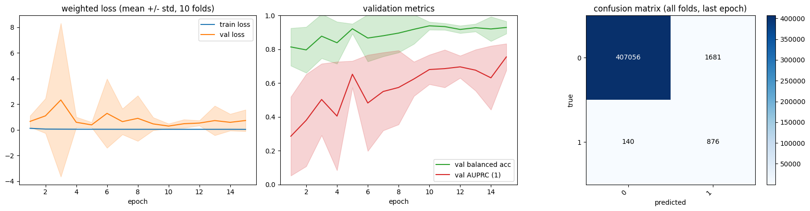

# EEG Seizure Detection — Improved Architecture

This is a work-in-progress experiment to create a new architecture for seizure detection using the CHB-MIT dataset. The architecture is based on the original paper [1], which is exactly reimplemented in [CNN_Seizure_Detection](../CNN_Seizure_Detection/Notebook.ipynb).

> [!WARNING]
> **Work in progress.** The architecture is not yet fully implemented and results are not final.

---

## What's in here

```
train_gpu.py            ← training script
Architectures.py        ← model definitions
configs/
  default_training_config.yaml   ← base hyperparameters
  experiments/
    ficnn_apen.yaml              ← FiCNN + raw EEG + ApEn conditioning
    ficnn_control.yaml           ← FiCNN + raw EEG + no conditioning
    ficrnn_atar_apen.yaml        ← FiCRNN + ATAR-denoised + ApEn (template with tune block)
utils.py                ← ApEn implementation
denois.py               ← ATAR denoising
```

---

## Data setup

Before training, run [../CHB-MIT_Formating/Reformating.ipynb](../CHB-MIT_Formating/Reformating.ipynb) to export the CHB-MIT dataset into per-patient `X.npy` / `y.npy` files. The default expected path is `../CHB-MIT_Formating/npy_data/`.


## Setting up a new experiment
To understand how the experimentation framework used in this folder works, take a look at [Experiments.md](Experiments.md).

## Results

| Metric | Current Architecture (CHB-MIT) | Paper reimplementation (Bonn) | Paper (Bonn) |
|---|---|---|---|
| Balanced accuracy | 92.91% ± 3.67 | — | — |
| Accuracy | 99.56% | 91.00% ± 4.73 | 88.67% |
| Sensitivity | 86.2% | 95.50% | 95.00% |
| Specificity | 99.59% | 91.00% | 90.00% |

Note: CHB-MIT has ~0.1–0.7% seizure windows vs. 50% in Bonn, so balanced accuracy is the primary metric here.

<div align="center">
  
  
  
</div>

---
### Observation
While developing FiCNN (wich add's feature wise linear modulation on top of U. Rajendra Acharya architecture), the code had a leakage issue wich yielded the following performence:
| Metric | 2 class FiCNN with leakage |
|-------------------|-----------------|
| Balanced accuracy | 92.91% ± 3.67   |
| Accuracy          | 99.56%          |
| Sensitivity       | 86.2%           |
| Specificity       | 99.59%          |

The leakage source came from the cross validation split wich was not patient wise. because of this FiCNN was recognizing patient specific seizure paterns.
This show that FiCNN is very efficient at learning those patient paterns wich could be interesting for potential calibration as model fine tuning for a specific person.   
   
This will be investigated in another experiment.

## Citations
