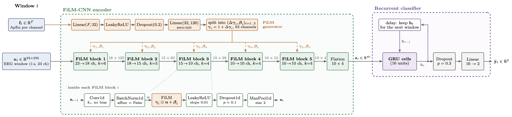
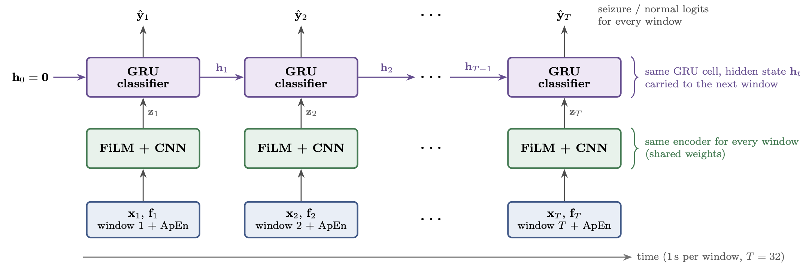

# EEG Seizure Detection — Improved Architecture

This is a work-in-progress experiment to create a new architecture for seizure detection using the CHB-MIT dataset. The architecture is based on the original paper [1], which is exactly reimplemented in [CNN_Seizure_Detection](../CNN_Seizure_Detection/Notebook.ipynb).

> [!WARNING]
> **Work in progress.** The architecture is not yet fully implemented and results are not final.

---

## What's in here

```
train_gpu.py            ← training script
Architectures.py        ← model definitions
comparing_results.py    ← builds results/experiments_comparison.png
Experiments.md          ← CLI, config system and how to add an experiment
Results.md              ← description and results of every experiment
configs/
  default_training_config.yaml   ← base hyperparameters
  experiments/                   ← one yaml per experiment (see Results.md)
results/<experiment>/   ← summary.json, history.json, summary.png, fold weights
utils.py                ← ApEn implementation
denois.py               ← ATAR denoising
```

---

## Data setup

Before training, run [../CHB-MIT_Formating/Reformating.ipynb](../CHB-MIT_Formating/Reformating.ipynb) to export the CHB-MIT dataset into per-patient `X.npy` / `y.npy` files. The default expected path is `../CHB-MIT_Formating/npy_data/`.

By default every patient folder is used, but the patients have different
channel counts. The reported results use the 10 patients with 23 channels:

```bash
python train_gpu.py --exp ficrnn_gru_apen --tune \
  --patients chb01 chb02 chb03 chb05 chb06 chb07 chb08 chb10 chb23 chb24
```


## Setting up a new experiment
To understand how the experimentation framework used in this folder works, take a look at [Experiments.md](Experiments.md).

## Results

The current best is **FiCRNN_GRU_APEN** (`configs/experiments/ficrnn_gru_apen.yaml`):
raw EEG, ApEn conditioning, 1 s windows at 256 Hz, sequences of 32 windows,
75% of the data, and patient-wise 10-fold cross-validation. Seizure windows
are only ~0.3% of the data used, so balanced accuracy and AUPRC are the
primary metrics.

| Metric | FiCRNN_GRU_APEN (CHB-MIT, patient-wise 10-fold) |
|---|---|
| Balanced accuracy | 82.1% ± 12.1% |
| AUPRC | 0.638 ± 0.233 |
| Sensitivity | 68.9% ± 24.0% |
| Specificity (pooled) | 95.0% |

Scores are taken at each fold's best epoch, chosen on that fold's held-out
patients, so they are optimistic. Every experiment, last-epoch scores, per-fold
results and training curves are in [Results.md](Results.md).

<div align="center">
  <p><b>FiCRNN_GRU_APEN detailed architecture</b></p>
  
  <p><b>FiCRNN_GRU_APEN unrolled over time</b></p>
  
</div>

### Architecture

FiCRNN_GRU classifies EEG one 1-second window at a time, using the previous
windows of the same 32-window sequence as context. It has two parts:

1. **FiLM-CNN encoder.** A 1D CNN of five convolutional blocks turns each
   23-channel window (256 samples) into a 40-dimensional feature vector.
   A small FiLM generator maps the window's per-channel approximate entropy
   (ApEn) to a scale γ and shift β for every channel of every block. These
   modulate the normalized convolution outputs, so the entropy features steer
   which patterns the CNN emphasises. The same encoder, with the same
   weights, is applied to every window.
2. **Recurrent classifier.** A unidirectional GRU (16 hidden units) reads the
   sequence of window features and carries a hidden state from one window to
   the next. A dropout and linear layer then outputs seizure / non-seizure
   logits for every window. The GRU only looks backward, so each prediction
   uses only the current and past windows. The hidden state is reset to zero
   at the start of every 32-window sequence.

Regularisation includes channel dropout in the conv blocks, dropout in the
FiLM generator and before the output layer, and a zero-initialised FiLM
generator, so training starts from an unmodulated CNN.

FiCRNN (`model: ficrnn`) is the same model with a vanilla RNN instead of the
GRU.

---
### Observation
While developing FiCNN (FiCNN is the Acharya CNN with feature-wise linear
modulation), the code had a leakage issue which yielded the following
performance:
| Metric | 2 class FiCNN with leakage |
|-------------------|-----------------|
| Balanced accuracy | 92.91% ± 3.67   |
| Accuracy          | 99.56%          |
| Sensitivity       | 86.2%           |
| Specificity       | 99.59%          |

The leakage came from a cross-validation split which was not patient-wise, so
FiCNN was recognizing patient-specific seizure patterns. This may be useful for
future patient-specific calibration, but these results are not a
generalization measure.

This will be investigated in another experiment.

## Sources
> [1] U. R. Acharya, S. L. Oh, Y. Hagiwara, J. H. Tan, and H. Adeli, “Deep Convolutional Neural Network for the Automated Detection and Diagnosis of Seizure Using EEG Signals,” Computers in Biology and Medicine, vol. 100, pp. 270–278, Sept. 2018, doi: 10.1016/j.compbiomed.2017.09.017.

> [2] K. N., M. L. Choo, U. R. Acharya, and Sadasivan, P.K, “Entropies for Detection of Epilepsy in EEG,” Computer Methods and Programs in Biomedicine, vol. 80, no. 3, pp. 187–194, Dec. 2005, doi: 10.1016/j.cmpb.2005.06.012.

> [3] E. Perez, F. Strub, H. de Vries, V. Dumoulin, and A. Courville, “FiLM: Visual Reasoning With a General Conditioning Layer,” Proceedings of the AAAI Conference on Artificial Intelligence, vol. 32, no. 1, 2018, doi: 10.1609/aaai.v32i1.11671.
