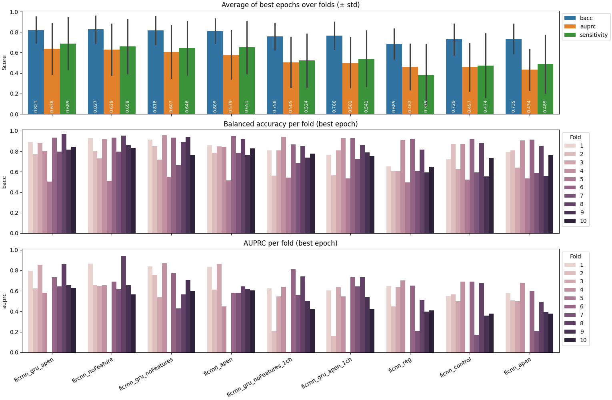
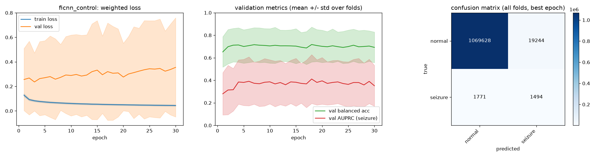
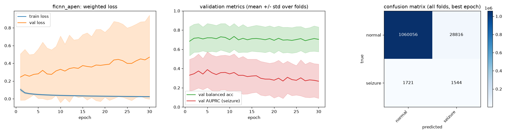
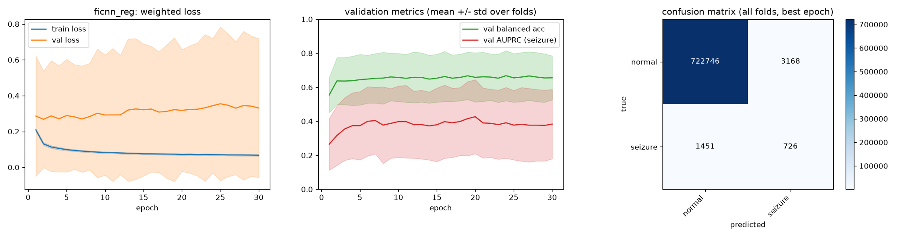
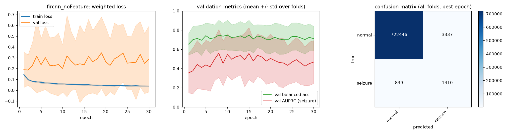
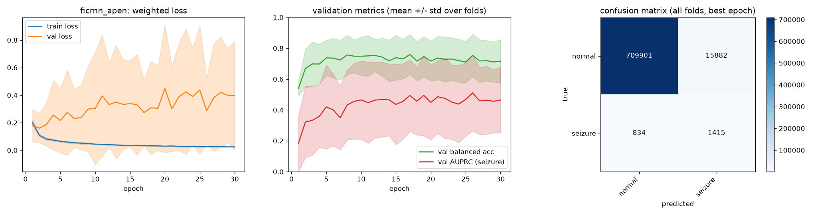
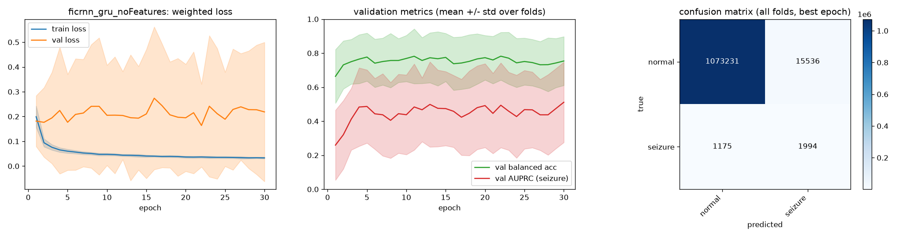
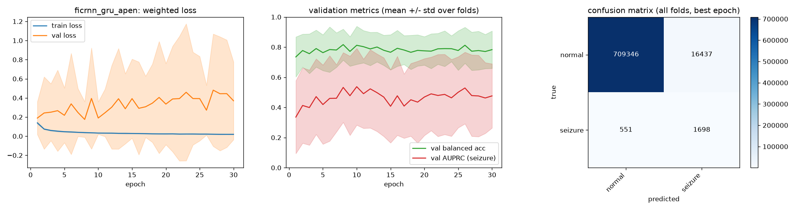
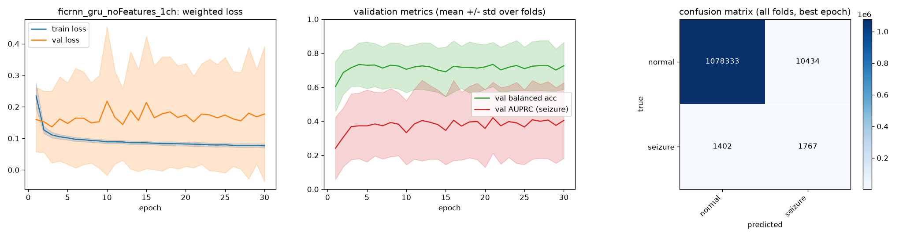
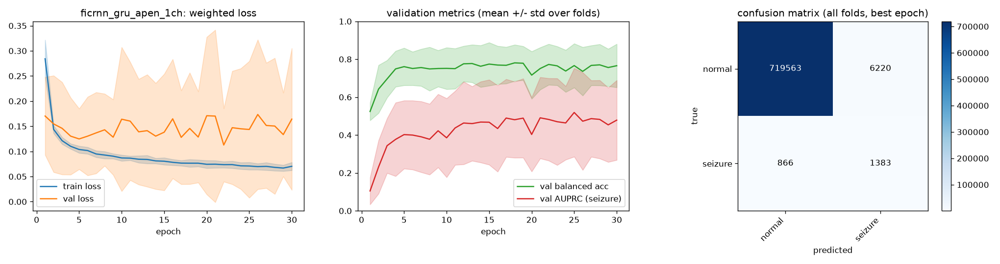

# Experiment results

Description and results of every experiment in
[`configs/experiments/`](configs/experiments/). Descriptions come from the
experiment yaml merged with
[`configs/default_training_config.yaml`](configs/default_training_config.yaml);
numbers come from `results/<experiment>/summary.json`.

> [!WARNING]
> Work in progress. The best epoch of each fold is the one with the highest
> AUPRC on that fold's held-out patients, so best-epoch numbers are optimistic.
> Last-epoch numbers are reported next to them for that reason.

---

## Shared setup

Every experiment uses the same training setup unless its section says
otherwise.

| Setting | Value |
|---|---|
| Data | CHB-MIT, 1 s windows at 256 Hz, 23 channels, raw EEG (`preprocess: raw`) |
| Patients | chb01, chb02, chb03, chb05, chb06, chb07, chb08, chb10, chb23, chb24 (the patients with 23 channels) |
| Subsampling | `data_fraction: 0.75`, stratified per patient; sequence models keep contiguous 32-window runs |
| Cross-validation | 10 folds, `StratifiedGroupKFold` grouped by patient, `seed: 123` |
| Training | 30 epochs, gradient clip 1.0, no early stopping (`patience: 0`) |
| Class weights | inverse frequency to the power 0.5 (`power: 0.5`) |
| Tuning | Optuna TPE + successive halving, run inside each outer fold: 15 trials × 3 inner folds × ≤ 10 epochs |
| Tuned search space | `lr` log-uniform 1e-5 to 1e-2, `weight_decay` log-uniform 1e-6 to 1e-2, `batch_size` in {128, 256, 512} |
| Selection metric | validation AUPRC (seizure class) |

About 1.09 M windows are used per experiment, of which about 3.2 k (≈ 0.3 %)
are seizure windows.

### Models

| `model` | Encoder | Classifier | Context |
|---|---|---|---|
| `ficnn` | 5 FiLM blocks (Conv1d → BatchNorm → FiLM → LeakyReLU → MaxPool), channels 18/15/10/10/10, kernels 6/5/4/4/4 | MLP 40 → 50 → 20 → 2 | one window |
| `ficnn_reg` | `ficnn` + Dropout1d 0.1 in each block, Dropout 0.2 in the FiLM generator | Dropout 0.3 → 40 → 16 → Dropout 0.3 → 2 | one window |
| `ficrnn` | `ficnn_reg` encoder (with its dropouts), shared across windows | vanilla RNN (16 units) → Dropout 0.3 → Linear 16 → 2 | 32 windows (32 s) |
| `ficrnn_gru` | `ficnn_reg` encoder (with its dropouts), shared across windows | GRU (16 units) → Dropout 0.3 → Linear 16 → 2 | 32 windows (32 s) |

`features: apen` feeds per-channel approximate entropy to the FiLM generator.
`features: none` feeds a constant 1 instead, so γ and β are learned constants:
the same network without input-dependent conditioning.

---

## Overview

### Experiment description

| Experiment | Model | Features | Preprocessing | Channels | Context |
|---|---|---|---|---|---|
| `ficnn_control` | `ficnn` | none | raw | 23 | 1 window |
| `ficnn_apen` | `ficnn` | ApEn | raw | 23 | 1 window |
| `ficnn_reg` | `ficnn_reg` | ApEn | raw | 23 | 1 window |
| `fircnn_noFeature` | `ficrnn` | none | raw | 23 | 32 windows |
| `ficrnn_apen` | `ficrnn` | ApEn | raw | 23 | 32 windows |
| `ficrnn_atar_apen` | `ficrnn` | ApEn | ATAR | 23 | 1 window (`sequence_len` not set) |
| `ficrnn_gru_noFeatures` | `ficrnn_gru` | none | raw | 23 | 32 windows |
| `ficrnn_gru_apen` | `ficrnn_gru` | ApEn | raw | 23 | 32 windows |
| `ficrnn_gru_noFeatures_1ch` | `ficrnn_gru` | none | raw | 1 | 32 windows |
| `ficrnn_gru_apen_1ch` | `ficrnn_gru` | ApEn | raw | 1 | 32 windows |

### Experiment results

Mean ± std over the 10 folds. BAcc, AUPRC and sensitivity are per-fold values
at each fold's best epoch. Specificity and precision are pooled over all folds
at the best epoch. Sorted by AUPRC.

| Experiment | BAcc | AUPRC | Sensitivity | Specificity | Precision | BAcc (last) | AUPRC (last) |
|---|---|---|---|---|---|---|---|
| `ficrnn_gru_apen` | 0.821 ± 0.121 | **0.638 ± 0.233** | **0.689 ± 0.240** | 0.9500 | 0.040 | 0.769 ± 0.138 | 0.506 ± 0.194 |
| `fircnn_noFeature` | **0.827 ± 0.126** | 0.629 ± 0.236 | 0.659 ± 0.251 | **0.9937** | **0.242** | 0.747 ± 0.153 | 0.427 ± 0.222 |
| `ficrnn_gru_noFeatures` | 0.818 ± 0.130 | 0.607 ± 0.242 | 0.646 ± 0.249 | 0.9857 | 0.114 | 0.754 ± 0.143 | **0.511 ± 0.236** |
| `ficrnn_apen` | 0.809 ± 0.113 | 0.579 ± 0.224 | 0.651 ± 0.241 | 0.9664 | 0.056 | **0.792 ± 0.145** | 0.472 ± 0.193 |
| `ficrnn_gru_noFeatures_1ch` | 0.758 ± 0.123 | 0.505 ± 0.232 | 0.524 ± 0.244 | 0.9904 | 0.145 | 0.726 ± 0.138 | 0.405 ± 0.223 |
| `ficrnn_gru_apen_1ch` | 0.766 ± 0.126 | 0.501 ± 0.231 | 0.541 ± 0.257 | 0.9913 | 0.162 | 0.710 ± 0.128 | 0.383 ± 0.211 |
| `ficnn_reg` | 0.685 ± 0.138 | 0.462 ± 0.210 | 0.379 ± 0.284 | 0.9909 | 0.116 | 0.680 ± 0.148 | 0.391 ± 0.219 |
| `ficnn_control` | 0.729 ± 0.141 | 0.457 ± 0.220 | 0.474 ± 0.294 | 0.9823 | 0.072 | 0.692 ± 0.136 | 0.352 ± 0.181 |
| `ficnn_apen` | 0.735 ± 0.137 | 0.434 ± 0.191 | 0.489 ± 0.268 | 0.9735 | 0.051 | 0.703 ± 0.128 | 0.268 ± 0.178 |
| `ficrnn_atar_apen` | not run | | | | | | |

*Top: mean of each fold's best epoch (± std). Middle and bottom: balanced
accuracy and AUPRC of every fold. Produced by
[`comparing_results.py`](comparing_results.py).*

### What the numbers show

- **Temporal context is the largest effect.** Going from one window (`ficnn*`)
  to 32-window sequences (`ficrnn*`) raises mean AUPRC from 0.43–0.46 to
  0.58–0.64 and balanced accuracy from 0.69–0.74 to 0.81–0.83. The sequence
  models also use the regularised encoder, but dropout alone does not explain
  the gain: `ficnn_reg` reaches 0.462 AUPRC against 0.434 for `ficnn_apen`.
- **One channel costs about 0.1 AUPRC.** `ficrnn_gru_*_1ch` reach 0.50–0.51
  against 0.61–0.64 with all 23 channels.
- **ApEn conditioning has no consistent effect on the mean.** AUPRC with ApEn
  minus without: −0.023 (FiCNN), −0.050 (FiCRNN), +0.031 (FiCRNN-GRU),
  −0.004 (FiCRNN-GRU, 1 ch). Every difference is far smaller than the fold
  std (≈ 0.2).
- **Fold 5 fails in every experiment** (AUPRC ≈ 0.001). It is the main
  source of the large std. Excluding it, the worst fold of
  `ficrnn_gru_apen` is 0.579 against 0.429 for `ficrnn_gru_noFeatures`, but
  for the vanilla RNN the order is reversed (0.450 with ApEn, 0.565 without).
- **ApEn models trade specificity for sensitivity.** With all 23 channels,
  the ApEn variants have lower pooled specificity than their unconditioned
  twins: 0.974 vs 0.982 (FiCNN), 0.966 vs 0.994 (FiCRNN), 0.950 vs 0.986
  (FiCRNN-GRU).
- **Best and last epoch differ by up to 0.2 AUPRC**, so the reported
  best-epoch scores depend on choosing the epoch on the test fold.

---

## Experiments

Each `summary.png` shows the weighted train and validation loss, the
validation balanced accuracy and AUPRC per epoch (mean ± std over folds), and
the confusion matrix pooled over all folds at the best epoch.

### FiCNN: one window at a time

`sequence_len: 1`, so every 1 s window is classified on its own.

#### `ficnn_control`

FiLM-CNN without conditioning (`features: none`). Baseline for the effect of
ApEn on the single-window model.

> [!NOTE]
> This is the experiment closest to Acharya et al. (2018): a 1-D CNN that
> classifies each window on its own, with no extra features. It is not a
> reimplementation; see [CNN_Seizure_Detection](../CNN_Seizure_Detection/) for
> that.

| BAcc | AUPRC | Sensitivity | Specificity |
|---|---|---|---|
| 0.729 ± 0.141 | 0.457 ± 0.220 | 0.474 ± 0.294 | 0.9823 |

#### `ficnn_apen`

FiLM-CNN conditioned on per-channel ApEn (`features: apen`).

| BAcc | AUPRC | Sensitivity | Specificity |
|---|---|---|---|
| 0.735 ± 0.137 | 0.434 ± 0.191 | 0.489 ± 0.268 | 0.9735 |

#### `ficnn_reg`

`ficnn_apen` with dropout in the conv blocks, the FiLM generator and the
classifier (`model: ficnn_reg`).

| BAcc | AUPRC | Sensitivity | Specificity |
|---|---|---|---|
| 0.685 ± 0.138 | 0.462 ± 0.210 | 0.379 ± 0.284 | 0.9909 |

### FiCRNN: 32 windows with a vanilla RNN

`sequence_len: 32`: the shared encoder embeds each window, and an RNN carries
a 16-unit hidden state across 32 consecutive windows (32 s). The hidden state
starts at zero for every sequence.

#### `fircnn_noFeature`

FiCRNN without conditioning (`features: none`).

| BAcc | AUPRC | Sensitivity | Specificity |
|---|---|---|---|
| 0.827 ± 0.126 | 0.629 ± 0.236 | 0.659 ± 0.251 | 0.9937 |

#### `ficrnn_apen`

FiCRNN conditioned on ApEn.

| BAcc | AUPRC | Sensitivity | Specificity |
|---|---|---|---|
| 0.809 ± 0.113 | 0.579 ± 0.224 | 0.651 ± 0.241 | 0.9664 |

#### `ficrnn_atar_apen`

FiCRNN conditioned on ApEn, on ATAR-denoised EEG (`preprocess: atar`) instead
of raw EEG. Unlike the other configs it does not set `sequence_len` (so it
falls back to 1) or `data_fraction` (so it uses all data), and its `tune`
block uses 8 trials on 1 fold. **No results yet.**

### FiCRNN-GRU: 32 windows with a GRU

Same as FiCRNN, with the vanilla RNN replaced by a GRU (`model: ficrnn_gru`).

#### `ficrnn_gru_noFeatures`

FiCRNN-GRU without conditioning.

| BAcc | AUPRC | Sensitivity | Specificity |
|---|---|---|---|
| 0.818 ± 0.130 | 0.607 ± 0.242 | 0.646 ± 0.249 | 0.9857 |

#### `ficrnn_gru_apen`

FiCRNN-GRU conditioned on ApEn. Highest mean AUPRC and sensitivity, but also
the most false positives.

| BAcc | AUPRC | Sensitivity | Specificity |
|---|---|---|---|
| 0.821 ± 0.121 | 0.638 ± 0.233 | 0.689 ± 0.240 | 0.9500 |

### FiCRNN-GRU on a single channel

`single_chanel_only: true`: only the first EEG channel is used.

#### `ficrnn_gru_noFeatures_1ch`

| BAcc | AUPRC | Sensitivity | Specificity |
|---|---|---|---|
| 0.758 ± 0.123 | 0.505 ± 0.232 | 0.524 ± 0.244 | 0.9904 |

#### `ficrnn_gru_apen_1ch`

| BAcc | AUPRC | Sensitivity | Specificity |
|---|---|---|---|
| 0.766 ± 0.126 | 0.501 ± 0.231 | 0.541 ± 0.257 | 0.9913 |

