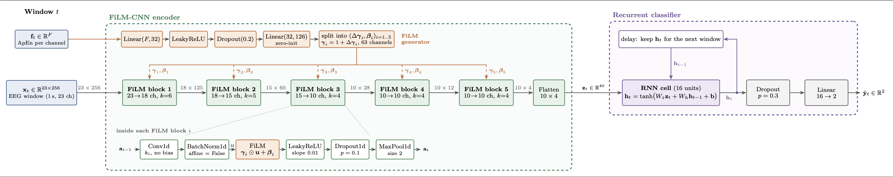
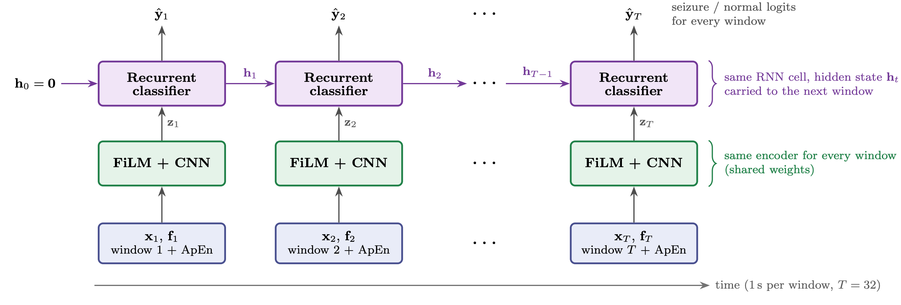

# seizureDetection

Work in progress research repository for EEG preprocessing, feature extraction,
and seizure classification. The project collects paper reproductions and
experimental code while working toward a usable seizure-detection software
application.

> [!WARNING]
> **This project and any future software produced from it are not intended for
> clinical use, medical diagnosis, treatment decisions, or emergency response.**
> The experiments are research and engineering work in progress, and their
> results must not be treated as medical advice or as a validated clinical
> device.

## Project objective

The project has two connected objectives:

1. Experiment with EEG preprocessing, signal-derived features, and neural
    network architectures to identify a promising seizure-detection approach.
2. Implement the resulting architecture as usable software, with a clear
    interface and reproducible processing and inference pipeline.

The repository combines reproducible baselines with experiments on artifact
removal, entropy features, convolutional neural networks, and larger clinical
EEG datasets. The architecture and software interface are still evolving.

## Latest Results

The current best is **FiCRNN**: FiCNN with an RNN classifier, using FiLM
conditioning on approximate entropy (ApEn). It was trained on raw CHB-MIT EEG
with 1 s windows, sequences of 32 windows, 50% of the data, and evaluated with
patient-wise 10-fold cross-validation.

| Metric            | FiCRNN + ApEn (CHB-MIT) |
|-------------------|-------------------------|
| Balanced accuracy | 79.47% ± 10.93          |
| AUPRC             | 0.586 ± 0.236           |

Seizure windows make up only ~0.1–0.7% of CHB-MIT, so balanced accuracy and
AUPRC are the primary metrics; plain accuracy is not informative here. An
earlier version used a cross-validation split that was not patient-wise and
reported 92.91% balanced accuracy; that result came from data leakage and is
superseded by the numbers above.

<div align="center">
  <p><b>FiCRNN detailed architecture</b></p>
  
  <p><b>FiCRNN unrolled over time</b></p>
  
</div>

## Repository structure
```text
.
|-- Experiments/
|   |-- Artifact_Removal/              Wavelet and thresholding denoising tests
|   |-- CHB-MIT_Formating/             CHB-MIT download and windowing pipeline
|   |-- CNN_Seizure_Detection/         Acharya CNN reproduction
|   |-- ECG_denoising/                 Separate ECG denoising exploration
|   |-- Entropy_Based_Fetures/         Entropy estimators and classification
|-- src/                               Shared preprocessing and data exploration
|-- doc/visuals/                       Generated figures used by documentation
`-- README.md                          Project overview
```

The `Experiments/` directory has its own guide. Start with
[Experiments/README.md](Experiments/README.md) for experiment purposes,
datasets, entry points, and links to the individual READMEs.

## Datasets
No datasets are included in this repository. The following datasets are used by the experiments:
- **Bonn University EEG:** used by the CNN and entropy experiments.
- **EEGdenoiseNet:** used to test artifact-removal methods.
- **CHB-MIT Scalp EEG Database:** currently being integrated for a larger,
  clinically oriented seizure/non-seizure dataset.
  preprocessing work.

## TODO
- [x] Reproduce Acharya CNN on Bonn EEG.
- [x] Reproduce & evaluate entropy features on Bonn EEG.
- [x] Reproduce wavelet based artifact removal on EEGdenoiseNet.
- [x] Integrate CHB-MIT Scalp EEG Database and window it for seizure/non-seizure analysis.
- [ ] Experiment with surface Laplacian preprocessing on CHB-MIT Scalp EEG Database.
- [x] Extend Acharya CNN with FiLM conditioning and denoising preprocessing using CHB-MIT Scalp EEG Database.
- [x] Experiment with recurrent neural networks integrated in the CNN architecture.

- [ ] implement the final architecture in C++.
- [ ] document the resulting C++ implementation and provide a command line interface for inference.

## Sources
> [1] U. R. Acharya, S. L. Oh, Y. Hagiwara, J. H. Tan, and H. Adeli, “Deep Convolutional Neural Network for the Automated Detection and Diagnosis of Seizure Using EEG Signals,” Computers in Biology and Medicine, vol. 100, pp. 270–278, Sept. 2018, doi: 10.1016/j.compbiomed.2017.09.017.

> [2] K. N., M. L. Choo, U. R. Acharya, and Sadasivan, P.K, “Entropies for Detection of Epilepsy in EEG,” Computer Methods and Programs in Biomedicine, vol. 80, no. 3, pp. 187–194, Dec. 2005, doi: 10.1016/j.cmpb.2005.06.012.

> [3] E. Perez, F. Strub, H. de Vries, V. Dumoulin, and A. Courville, “FiLM: Visual Reasoning With a General Conditioning Layer,” Proceedings of the AAAI Conference on Artificial Intelligence, vol. 32, no. 1, 2018, doi: 10.1609/aaai.v32i1.11671.

> [4] N. Bajaj, Wavelets for EEG Analysis. IntechOpen, 2020. Accessed: Sept. 17, 2026. [Online]. Available: https://www.intechopen.com/chapters/74032

> [5] N. S. Amer and S. B. Belhaouari, “EEG Signal Processing for Medical Diagnosis, Healthcare, and Monitoring: A Comprehensive Review,” IEEE Access, vol. 11, pp. 143116–143142, 2023, doi: 10.1109/access.2023.3341419.
