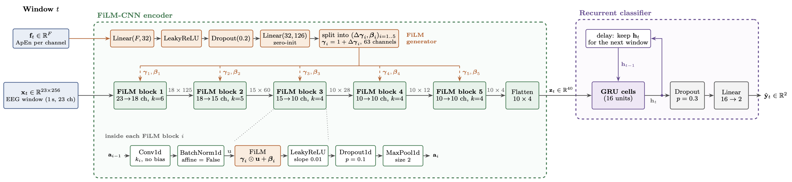
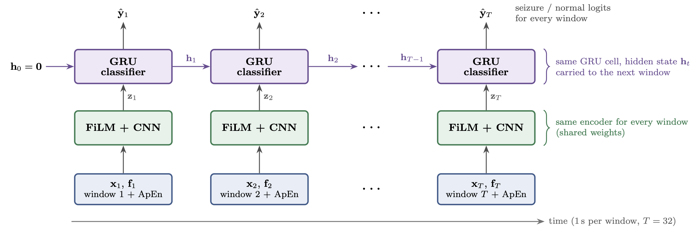

# seizureDetection

Work-in-progress research repository developing an original architecture for EEG-based seizure detection. The project reproduces established methods from the literature as verified baselines, then builds on them through successive experiments toward a performant, deployable detector. The current best architecture is FiCRNN_GRU_APEN (see Latest Results). It is the leading candidate so far, not the final design: the architecture is still evolving as experiments continue.

> [!WARNING]
> **This project and any future software produced from it are not intended for
> clinical use, medical diagnosis, treatment decisions, or emergency response.**
> The experiments are research and engineering work in progress, and their
> results must not be treated as medical advice or as a validated clinical
> device.

## Project objective

The project has three connected objectives:

1. **Reproduce** established seizure-detection methods from the literature (CNN classification, entropy features, wavelet artifact removal) as verified baselines, confirming reported results before building on them.
2. **Develop** an original architecture by iterating on these baselines — currently FiCRNN_GRU_APEN, which conditions a CNN–GRU on signal-derived entropy features evaluated honestly under patient-wise cross-validation and extreme class imbalance. The architecture is an active work in progress.
3. **Deliver** the resulting architecture as usable software, with a reproducible preprocessing and inference pipeline and a clear interface.

## Latest Results

The current best is **FiCRNN_GRU_APEN**: a FiLM-conditioned CNN with a GRU
recurrent classifier. The FiLM conditioning features are the approximate
entropy (ApEn) of each channel of each window. It was trained on raw CHB-MIT
EEG with 1 s windows, sequences of 32 windows, 75% of the data, and evaluated
with patient-wise 10-fold cross-validation.

Seizure windows make up only ~0.1–0.7% of CHB-MIT, so balanced accuracy and
AUPRC (area under the precision-recall curve) are the primary metrics; plain accuracy is not informative here.

| Metric            | FiCRNN_GRU_APEN (CHB-MIT) |
|-------------------|-------------------------|
| Balanced accuracy | 82.1% ± 12.1%           |
| AUPRC             | 0.638 ± 0.233           |

These numbers come from a subset of CHB-MIT: 10 patients with 23 EEG channels
(chb01, chb02, chb03, chb05, chb06, chb07, chb08, chb10, chb23, chb24). Each
patient is randomly subsampled to 75% of its windows. The high standard
deviation is currently being addressed: one fold fails in every experiment
(AUPRC ≈ 0.001).

> [!NOTE]
> See
> [Results.md](/Experiments/CNN_Seizure_Detection_improved/Results.md) for
> every architecture, last-epoch scores and per-fold results.

<div align="center">
  <p><b>FiCRNN_GRU_APEN detailed architecture</b></p>
  
  <p><b>FiCRNN_GRU_APEN unrolled over time</b></p>
  
  <p><b>Architectures Comparison</b></p>
  
</div>

## Repository structure
```text
.
|-- Experiments/
|   |-- Artifact_Removal/              Wavelet and thresholding denoising tests
|   |-- CHB-MIT_Formating/             CHB-MIT download and windowing pipeline
|   |-- CNN_Seizure_Detection/         Acharya CNN reproduction
|   |-- CNN_Seizure_Detection_improved/ FiLM-CNN / FiCRNN / FiCRNN_GRU on CHB-MIT
|   |-- Architecture_Optimizer/        Architecture search (unfinished)
|   |-- ECG_denoising/                 Separate ECG denoising exploration
|   |-- Entropy_Based_Fetures/         Entropy estimators and classification
|-- src/                               Shared preprocessing and data exploration
|-- doc/
|   |-- figs/                          Architecture figures (TikZ sources)
|   |-- visuals/                       Generated figures used by documentation
`-- README.md                          Project overview
```

The `Experiments/` directory has its own guide. Start with
[Experiments/README.md](Experiments/README.md) for experiment purposes,
datasets, entry points, and links to the individual READMEs.

## Datasets
No datasets are included in this repository. The following datasets are used by the experiments:
- **Bonn University EEG:** used by the CNN and entropy experiments.
- **EEGdenoiseNet:** used to test artifact-removal methods.
- **CHB-MIT Scalp EEG Database:** used as 1 second windows for the FiLM-conditioned models.

## TODO
- [x] Reproduce Acharya CNN on Bonn EEG.
- [x] Reproduce & evaluate entropy features on Bonn EEG.
- [x] Reproduce wavelet based artifact removal on EEGdenoiseNet.
- [x] Integrate CHB-MIT Scalp EEG Database and window it for seizure/non-seizure analysis.
- [x] Extend Acharya CNN with FiLM conditioning using CHB-MIT Scalp EEG Database.
- [ ] Evaluate ATAR denoising preprocessing on CHB-MIT Scalp EEG Database.
- [x] Experiment with recurrent neural networks integrated in the CNN architecture.
- [ ] Experiment with surface Laplacian preprocessing on CHB-MIT Scalp EEG Database.
- [ ] Experiment with local detrended fluctuation analysis.

- [ ] implement the final architecture in C++.
- [ ] document the resulting C++ implementation and provide a command line interface for inference.

## Sources
> [1] U. R. Acharya, S. L. Oh, Y. Hagiwara, J. H. Tan, and H. Adeli, “Deep Convolutional Neural Network for the Automated Detection and Diagnosis of Seizure Using EEG Signals,” Computers in Biology and Medicine, vol. 100, pp. 270–278, Sept. 2018, doi: 10.1016/j.compbiomed.2017.09.017.

> [2] K. N., M. L. Choo, U. R. Acharya, and Sadasivan, P.K, “Entropies for Detection of Epilepsy in EEG,” Computer Methods and Programs in Biomedicine, vol. 80, no. 3, pp. 187–194, Dec. 2005, doi: 10.1016/j.cmpb.2005.06.012.

> [3] E. Perez, F. Strub, H. de Vries, V. Dumoulin, and A. Courville, “FiLM: Visual Reasoning With a General Conditioning Layer,” Proceedings of the AAAI Conference on Artificial Intelligence, vol. 32, no. 1, 2018, doi: 10.1609/aaai.v32i1.11671.

> [4] N. Bajaj, Wavelets for EEG Analysis. IntechOpen, 2020. Accessed: Sept. 17, 2026. [Online]. Available: https://www.intechopen.com/chapters/74032

> [5] N. S. Amer and S. B. Belhaouari, “EEG Signal Processing for Medical Diagnosis, Healthcare, and Monitoring: A Comprehensive Review,” IEEE Access, vol. 11, pp. 143116–143142, 2023, doi: 10.1109/access.2023.3341419.

> [6] L. Tang, M. Zhao, and X. Wu, “Accurate Classification of Epilepsy Seizure Types Using Wavelet Packet Decomposition and Local Detrended Fluctuation Analysis,” Electronics Letters, vol. 56, no. 17, pp. 861–863, Aug. 2020, doi: 10.1049/el.2020.1471.
